<!-- =============================================================== -->
<!--   KEVYN.DEV / GitHub Profile — Cyber Interface                     -->
<!--   Arquivos de apoio: assets/boot-banner.svg e .github/workflows/snake.yml -->
<!-- =============================================================== -->

<div align="center">
  

  <a href="https://github.com/DenverCoder1/readme-typing-svg">
    
  </a>

  <p>
    
    
    
  </p>

  <a href="#-01--sobre-mim">Sobre</a> &nbsp;•&nbsp;
  <a href="#-02--tech-stack">Stack</a> &nbsp;•&nbsp;
  <a href="#-04--projetos">Projetos</a> &nbsp;•&nbsp;
  <a href="#-06--telemetria-github">Estatísticas</a> &nbsp;•&nbsp;
  <a href="#-09--conexões">Contato</a>
</div>

---

## `◈ 01 / SOBRE MIM`

> Olá! Sou **Kevyn Deusdará**, estudante de tecnologia e desenvolvedor em formação. Gosto de transformar ideias em projetos funcionais, explorar novas ferramentas e evoluir um commit de cada vez.

```yaml
user: kevyndeusdara
identity: Kevyn Deusdará
profile: Estudante de TI | Developer in progress
focus:
  - Desenvolvimento web
  - Python e automação
  - Lógica e soluções práticas
interests:
  - Projetos criativos
  - Bots e sistemas interativos
  - Aprendizado contínuo
status: building_and_learning
```

## `◈ 02 / TECH STACK`

<div align="center">
  <p><strong>// Linguagens com as quais desenvolvo e estudo</strong></p>
  
  <p>
    
    
    
    
  </p>
</div>

## `◈ 03 / DEV TOOLKIT`

<div align="center">
  
</div>

<br />

- **Versionamento:** Git e GitHub
- **Editor:** Visual Studio Code
- **Banco de dados:** SQLite
- **Práticas:** HTML semântico, layouts responsivos, JavaScript e aplicações com Python

## `◈ 04 / PROJETOS`

<div align="center">
  <a href="https://github.com/kevyndeusdara/Mesa-Aberta-ONG"></a>
  <br />
  <a href="https://github.com/kevyndeusdara?tab=repositories"></a>
  <br />
  <a href="https://github.com/kevyndeusdara/Mesa-Aberta-ONG"></a>
  <a href="https://kevyndeusdara.github.io/Mesa-Aberta-ONG/"></a>
</div>

<sub><strong>Mesa Aberta</strong> é um projeto acadêmico público e publicado. O segundo card indica estudos e experimentos futuros, não um repositório já lançado.</sub>

## `◈ 05 / CURRENT OBJECTIVES`

```console
kevyn@devstation:~$ cat ./roadmap.txt

[✓] Construir projetos reais com HTML, CSS e JavaScript
[>] Evoluir em Python e automação
[>] Melhorar organização, lógica e legibilidade de código
[>] Aprender mais sobre bancos de dados e integração de sistemas
[ ] Publicar novos projetos e documentar minha evolução

SYSTEM STATUS: LEARNING IN PROGRESS ▓▓▓▓▓▓▓░░░
kevyn@devstation:~$ _
```

## `◈ 06 / TELEMETRIA GITHUB`

<div align="center">
  <a href="https://github.com/kevyndeusdara">
    
  </a>
  <a href="https://github.com/kevyndeusdara?tab=repositories">
    
  </a>
  <br /><br />
  
  <br /><br />
  <a href="https://github.com/kevyndeusdara">
    
  </a>
</div>

<sub>Observação: estatísticas automáticas consideram os dados públicos disponíveis e podem não refletir projetos privados.</sub>

## `◈ 07 / ACHIEVEMENTS UNLOCKED`

<div align="center">
  
</div>

## `◈ 08 / CONTRIBUTION SNAKE`

<div align="center">
  <picture>
    <source media="(prefers-color-scheme: dark)" srcset="https://raw.githubusercontent.com/kevyndeusdara/kevyndeusdara/output/github-snake-dark.svg" />
    <source media="(prefers-color-scheme: light)" srcset="https://raw.githubusercontent.com/kevyndeusdara/kevyndeusdara/output/github-snake.svg" />
    
  </picture>
</div>

<sub>A animação acima aparece após a primeira execução do workflow <code>.github/workflows/snake.yml</code>.</sub>

## `◈ 09 / CONEXÕES`

<div align="center">
  <p>Tem um projeto interessante ou quer trocar ideias sobre desenvolvimento?</p>
  <a href="https://github.com/kevyndeusdara"></a>
  <a href="https://github.com/kevyndeusdara?tab=repositories"></a>
</div>

<br />

<div align="center">
  
  <p><samp>◉ CONNECTION ESTABLISHED // THANKS FOR VISITING</samp></p>
  <sub>Designed with curiosity · Maintained with code · <b>Kevyn Deusdará</b></sub>
</div>
